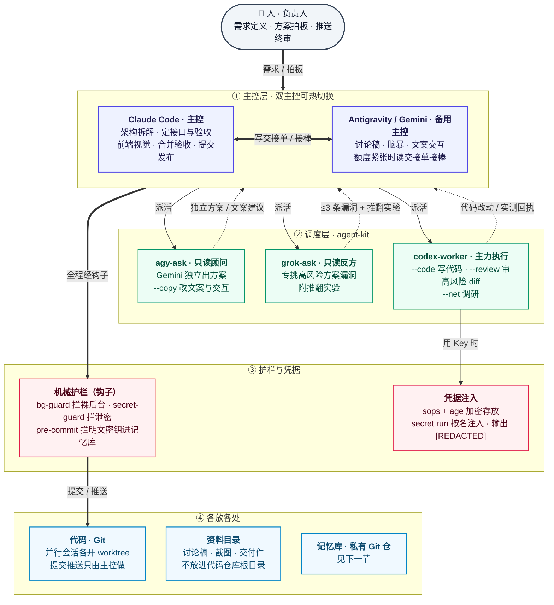
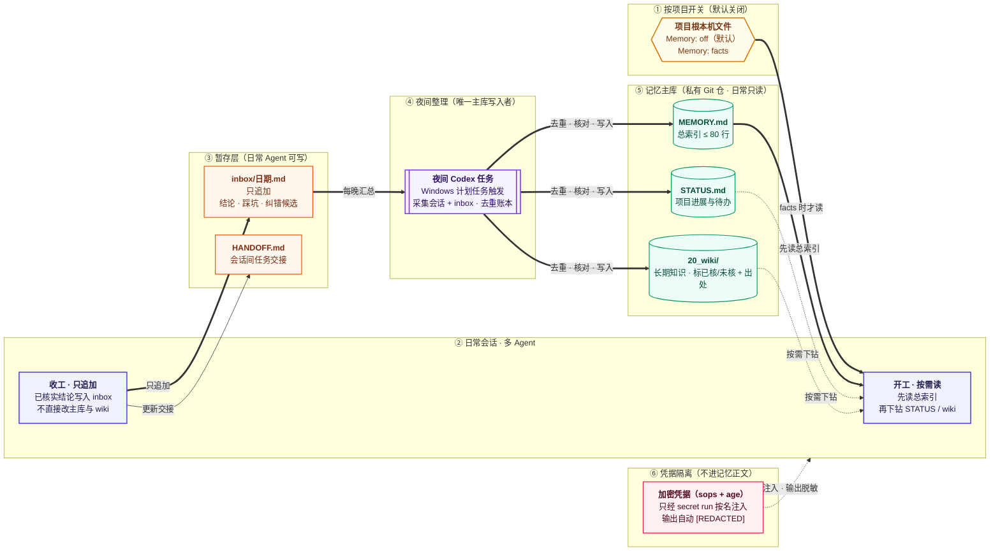

# 多模型协作与工程记忆架构

> 一套面向单台 Windows 电脑的多模型协同开发与长期记忆方案。核心思路：**把模型当成偏科的团队成员来分工，用脚手架和机械护栏控质量、控安全，用读写分离的轻量 Git 仓库做跨会话记忆。**
>
> 可交互版本：用浏览器打开 [`live-demo.html`](live-demo.html)，按 `1` `2` 切视图，点节点看讲解。

---

## 一、多模型协作架构

> 图例：粗实线 = 主流程（需求、强制经过的护栏）；细实线 = 派活 / 调用；虚线 = 回执。

### 设计要点
1. **按模型性格分工**：Claude 主管拆解、审美与验收；Gemini 当独立军师和文案交互顾问（额度紧张时接棒主控）；Codex 承接成块后端/脚本、高风险审查和调研；Grok 只在高风险方案上当反方挑错。
2. **双主控热切换**：两家额度池独立，切主控前落盘约 30～40 行的 `.agent-handoff.md`（记录目标、已拍板决定、已验证/未验证状态和活跃 worker），另一家读完接棒。
3. **机械护栏替代口头提醒**：能写成脚本或钩子硬拦的，不只写进提示词——防野后台丢任务、防明文读私钥、防明文密钥入库。
4. **派活脚本把规矩写死**：`codex-worker` 的三个档位各自固定规则和回执格式（Windows 上 Codex 沙箱不稳，三档都不开沙箱，靠规则约束）；`agy-ask` 用只读白名单、`grok-ask` 用 plan 模式，都只读；主控不裸调 `codex exec`。

### 「高风险三类」

`grok-ask` 反方审稿和 `codex-worker --review` 只用在这三类上，按你的项目改：

- 硬件通信或烧录（改协议、刷固件）
- 可能丢数据或泄露凭据（存储迁移、删除逻辑、凭据处理）
- 高风险的用户承诺（对外文案里写到的功能、数字、保证）

---

## 二、工程记忆架构

> 读法：沿 ② 收工 → ③ 暂存 → ④ 夜间整理 → ⑤ 主库 → ② 开工 形成闭环；日常会话只读主库、只写暂存，主库只有夜间任务一个写入者。

### 设计要点
1. **默认关闭、按需加载**：未声明记忆模式的项目默认 `Memory: off`；开启 `Memory: facts` 时先只读不超过 80 行的 `MEMORY.md`，再按需读具体项目的 `STATUS.md` 或 `20_wiki/`，省上下文。
2. **每页单一写入者（读写分离）**：日常 Agent 只往 `inbox/` 追加和更新 `HANDOFF.md`；`MEMORY.md` 滚动区、`STATUS.md` 和 `20_wiki/` 只由夜间整理任务写，从结构上消灭并发写冲突和垃圾堆积。
3. **证据与溯源**：wiki 每条标「已核 / 未核」及出处（提交号或会话 ID），避免旧推测被后续会话当成既定事实；`未核` 条目 30 天移到「待核」、60 天删除。
4. **夜间整理自带护栏**：大删改不直推 main，改推 `dream/<日期>` 分支等人审；来源不全的晚上不做按时间的删除；提交前扫明文密钥。完整流程见 [`memory-template/ops/dreaming.md`](../memory-template/ops/dreaming.md)。
5. **严格边界**：明文凭据绝不进入记忆库，统一走 `sops + age` 加密和 `secret run` 按名注入并脱敏。
